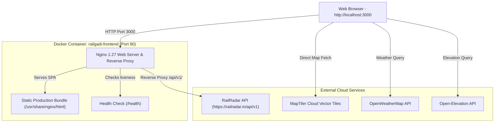

# 🚆 RailGadi — Real-Time Indian Railways Journey Intelligence & Tracking

**RailGadi** is a modern, high-performance web application designed for real-time Indian Railway train tracking, live route visualization, delay prediction analytics, elevation profiling, and smart journey telemetry.

This project is fully containerized using **Docker** and **Docker Compose**, providing an isolated, reliable, production-ready environment that can be deployed anywhere with a single command.

---

## 📑 Table of Contents
1. [Project Overview](#-project-overview)
2. [Key Application Features](#-key-application-features)
3. [Technology Stack](#-technology-stack)
4. [Application Architecture](#-application-architecture)
5. [Docker Deployment Prerequisites](#-docker-deployment-prerequisites)
6. [Dockerfile Deep Dive](#-dockerfile-deep-dive)
7. [Docker Compose Configuration](#-docker-compose-configuration)
8. [Environment Variable Setup](#-environment-variable-setup)
9. [Application Startup & Shutdown](#-application-startup--shutdown)
10. [College Demonstration Script & Workflow](#-college-demonstration-script--workflow)
11. [Troubleshooting & FAQ](#-troubleshooting--faq)
12. [Developer & Linting Setup](#-developer--linting-setup)

---

## 🌟 Project Overview
RailGadi bridges telemetry data from Indian Railways (via the RailRadar API and intelligent fallback simulation) with modern GIS mapping and machine learning-driven delay forecasting. It delivers an intuitive, dashboard-grade experience for passengers, railway enthusiasts, and analysts to track train runs, inspect intermediate stations, view platform allocations, analyze elevation profiles across railway corridors, and plan travel.

---

## 🚀 Key Application Features
- **Real-Time Train Search & Autocomplete:** Instant search by train number (e.g., `12727`, `12626`, `12951`, `22436`, `12002`) or name with smart debouncing.
- **Live Route & GPS Visualization:** Interactive vector maps powered by MapLibre GL and MapTiler, showing accurate polyline paths snapped to actual track geometries using Turf.js.
- **Predictive Delay Intelligence:** Algorithms estimating delay propagation and recovery times for upcoming stations.
- **Station Timeline & Platform Info:** Detailed list of past, current, and upcoming halts with arrival/departure schedules, halt durations, and platform allocations.
- **Elevation Profiling:** Dynamic elevation gradient charts across the entire journey corridor.
- **Analytics & Travel Companion:** Speed tracking, delay distribution charts, coach position finders, and weather conditions at stations.
- **Resilient Fallback Engine:** Built-in offline and fallback dataset ensuring that popular Indian express trains demonstrate seamlessly even if external APIs face network throttling.

---

## 🛠️ Technology Stack

| Layer | Technologies |
|---|---|
| **Frontend Framework** | React 19 (TypeScript) |
| **Build Tool & Bundler** | Vite 8 + SWC/Oxc |
| **State Management** | Zustand |
| **Data Fetching & Cache** | TanStack React Query v5 |
| **GIS & Mapping** | MapLibre GL, MapTiler SDK, Turf.js |
| **UI Components & Icons** | Lucide React, Recharts |
| **Container Engine** | Docker Engine 29+ |
| **Orchestration** | Docker Compose v5+ |
| **Production Web Server** | Nginx 1.27 Alpine |

---

## 🏛️ Application Architecture



- **Client-Side SPA Architecture:** The frontend is compiled into minified static assets (`HTML`, `JS`, `CSS`).
- **Nginx Reverse Proxy:** Nginx serves the compiled SPA, handles client-side routing fallback (`try_files $uri $uri/ /index.html;`), and securely proxies requests made to `/api/v1/` to the RailRadar API without triggering browser CORS issues.
- **No Database Required:** Application state is managed via client-side storage, with dynamic real-time caching handled by React Query.

---

## 📋 Docker Deployment Prerequisites
Before deploying RailGadi with Docker, ensure the following are installed:
1. **Docker Desktop** (version 20.10+ or newer) with WSL2 enabled on Windows:
   ```powershell
   docker --version
   docker compose version
   ```
2. **Git** (to clone the repository).
3. Ensure port **3000** is available on your machine (can be customized in `docker-compose.yml`).

---

## 🐳 Dockerfile Deep Dive

The project utilizes an industry-standard **Multi-Stage Dockerfile** to minimize image size and eliminate development overhead:

### Stage 1: Build Stage (`node:22-alpine`)
- Uses a lightweight Node.js Alpine base.
- Copies only `package.json` and `package-lock.json` first to maximize Docker layer caching during `npm ci`.
- Injects `ARG` build variables prefixed with `VITE_` into the environment so Vite bakes them into the client bundle.
- Copies the application source code and runs `npm run build` (`tsc -b && vite build`), compiling TypeScript to minified JavaScript and CSS in `/app/dist`.

### Stage 2: Production Stage (`nginx:1.27-alpine`)
- Uses an ultra-lightweight Nginx Alpine base.
- Discards all Node.js runtimes, development tools, and `node_modules` (reducing image size to ~21 MB).
- Copies the compiled `/app/dist` folder into `/usr/share/nginx/html`.
- Mounts custom `nginx.conf` configured for Single Page Application routing, Gzip compression, and `/api/v1/` reverse proxying.
- Defines a container `HEALTHCHECK` probing `http://127.0.0.1/health`.

---

## 📦 Docker Compose Configuration (`docker-compose.yml`)

`docker-compose.yml` orchestrates the build and runtime parameters in a declarative format:

```yaml
services:
  railgadi-web:
    build:
      context: .
      dockerfile: Dockerfile
      args:
        VITE_APP_NAME: ${VITE_APP_NAME:-RailGaadi}
        VITE_APP_VERSION: ${VITE_APP_VERSION:-2.0.0}
        VITE_MAPTILER_API_KEY: ${VITE_MAPTILER_API_KEY}
        VITE_RAILRADAR_API_KEY: ${VITE_RAILRADAR_API_KEY}
        VITE_RAILRADAR_BASE_URL: ${VITE_RAILRADAR_BASE_URL:-/api/v1}
        VITE_OPENWEATHER_API_KEY: ${VITE_OPENWEATHER_API_KEY}
        VITE_OPENWEATHER_BASE_URL: ${VITE_OPENWEATHER_BASE_URL:-https://api.openweathermap.org/data/2.5}
        VITE_OPENELEVATION_BASE_URL: ${VITE_OPENELEVATION_BASE_URL:-https://api.open-elevation.com/api/v1/lookup}
        VITE_OPENTOPO_API_KEY: ${VITE_OPENTOPO_API_KEY}
        VITE_API_BASE_URL: ${VITE_API_BASE_URL:-/api}
        VITE_JOURNEY_REFRESH_INTERVAL_MS: ${VITE_JOURNEY_REFRESH_INTERVAL_MS:-60000}
        VITE_SEARCH_DEBOUNCE_MS: ${VITE_SEARCH_DEBOUNCE_MS:-350}
    image: railgadi-frontend:latest
    container_name: railgadi-frontend
    ports:
      - "3000:80"
    restart: unless-stopped
    healthcheck:
      test: ["CMD-SHELL", "wget --spider -q http://127.0.0.1/health || exit 1"]
      interval: 15s
      timeout: 3s
      retries: 3
      start_period: 5s
    networks:
      - railgadi-network

networks:
  railgadi-network:
    driver: bridge
```

---

## 🔑 Environment Variable Setup

1. Inspect the template file `.env.example`:
   ```powershell
   cp .env.example .env
   ```
2. Configure your keys in `.env` (or use the built-in defaults):
   - `VITE_MAPTILER_API_KEY`: API key for vector map tiles.
   - `VITE_RAILRADAR_API_KEY`: API key for live train data.
   - `VITE_OPENWEATHER_API_KEY`: API key for live weather data.
   - `VITE_OPENTOPO_API_KEY`: API key for elevation data.

> [!NOTE]
> `.dockerignore` excludes `.env` and `.git` from being baked into the Docker image directly. Build-time arguments in `docker-compose.yml` pass necessary values safely to Vite.

---

## ⚡ Application Startup & Shutdown

### 1. Build and Start Application
```powershell
docker compose up --build -d
```

### 2. Verify Container Health
```powershell
docker compose ps
```
Expected output:
```
NAME                IMAGE                      STATUS                    PORTS
railgadi-frontend   railgadi-frontend:latest   Up 30 seconds (healthy)   0.0.0.0:3000->80/tcp
```

### 3. View Runtime Logs
```powershell
docker compose logs -f
```

### 4. Access the Application in Browser
Open your browser and navigate to:
```
http://localhost:3000
```

### 5. Stop the Application
```powershell
docker compose down
```

---

## 🎓 College Demonstration Script & Workflow

Use this step-by-step checklist and speaking guide during your college presentation:

### Step 1: Project Overview & File Inspection
**Command:**
```powershell
dir
```
**Speaking Script:**
> *"Good morning. Today I am demonstrating the containerized deployment of RailGadi, an Indian Railways real-time tracking and journey intelligence platform built with React, TypeScript, and Vite. As shown in the directory, we have containerized the app using a multi-stage Dockerfile, custom Nginx reverse proxy configuration, and a docker-compose.yml file."*

### Step 2: Explain Dockerfile & Multi-Stage Build
**Command:**
```powershell
Get-Content Dockerfile
```
**Speaking Script:**
> *"We implemented a multi-stage build. In Stage 1, a Node 22 Alpine builder compiles TypeScript into an optimized Vite bundle. In Stage 2, we copy only the compiled static assets into an ultra-lean Nginx 1.27 Alpine web server. This drops the image size down to just ~21 megabytes and ensures that no development tools or source code are exposed in production."*

### Step 3: Build & Start with Docker Compose
**Command:**
```powershell
docker compose up --build -d
```
**Speaking Script:**
> *"With a single command — `docker compose up --build -d` — Docker builds the image, sets up our isolated bridge network, starts the container, and maps host port 3000 to container port 80."*

### Step 4: Show Running Containers and Health Checks
**Command:**
```powershell
docker compose ps
docker images railgadi-frontend
```
**Speaking Script:**
> *"Running `docker compose ps` shows that the container `railgadi-frontend` is actively running and marked 'healthy' by our automated health check endpoint at `/health`. Looking at `docker images`, our final production image is exceptionally lightweight."*

### Step 5: Live Browser Demonstration
1. Open `http://localhost:3000` in the browser.
2. Search for `12727` or click **Godavari Superfast Express**.
3. Point out:
   - Live route map and GPS tracking.
   - Delay analytics and prediction timeline.
   - Elevation profile chart.
   - Platform numbers and station timetable.
**Speaking Script:**
> *"Inside the browser at port 3000, we see the complete application running smoothly inside the Docker container. Nginx seamlessly serves all assets, prevents CORS issues by reverse proxying `/api/v1` to the backend data source, and handles client-side routing."*

### Step 6: Graceful Shutdown
**Command:**
```powershell
docker compose down
```
**Speaking Script:**
> *"Finally, we run `docker compose down` to gracefully stop and remove the containers and network cleanly."*

---

## 🔧 Troubleshooting & FAQ

| Problem | Cause | Solution |
|---|---|---|
| `failed to connect to the docker API` | Docker Desktop daemon is not running | Launch Docker Desktop from the Start menu and wait until it indicates 'Engine running'. |
| Port 3000 already in use | Another application is bound to port 3000 | Change `"3000:80"` to `"8080:80"` or `"5000:80"` in `docker-compose.yml`. |
| Unhealthy container status | Healthcheck endpoint unreachable | Verify Nginx is listening on dual-stack (`listen 80; listen [::]:80;`) and that `/health` returns HTTP 200. |
| Map tiles not displaying | Invalid or empty MapTiler key | Verify `VITE_MAPTILER_API_KEY` in `.env` and rebuild with `docker compose up --build -d`. |

---

## 💻 Developer & Linting Setup

For local development without Docker:
```bash
npm install
npm run dev
```

To run TypeScript type checks and production builds:
```bash
npm run build
```

To run Oxlint:
```bash
npm run lint
```
