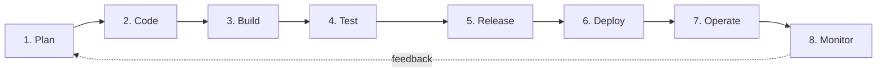

# 🚆 RailGadi

> Real-Time Indian Railways Journey Intelligence & Live Tracking Platform

[](#-docker-deployment)
[](https://react.dev/)
[](https://www.typescriptlang.org/)
[](https://vitejs.dev/)
[](https://nginx.org/)
[](#-devops-lifecycle)
[](#4-test)

**RailGadi** is an intelligent Indian Railways live tracking platform that combines real-time telemetry, predictive delay analytics, track elevation profiling, and interactive GIS mapping to provide seamless journey intelligence.

---

## ✨ Key Features

- **Live GPS Tracking & Route Alignment:** Polyline track snapping using Turf.js and MapLibre GL for accurate train positions.
- **Predictive Delay Intelligence:** Dynamic algorithm estimating delay propagation and recovery times for upcoming halts.
- **Station Timetable & Platform Allocations:** Live arrival/departure schedules, halt durations, and platform updates.
- **Route Elevation Profiling:** Dynamic track elevation gradient charts across railway corridors.
- **Coach & Speed Analytics:** Real-time speed telemetry and coach position indicator.
- **Resilient Fallback Mode:** Built-in offline and fallback simulation for major express corridors.

---

## 🛠️ Tech Stack

- **Frontend:** React 19, TypeScript, Vite 8, Zustand, TanStack React Query v5
- **GIS & Mapping:** MapLibre GL, MapTiler SDK, Turf.js
- **Containerization:** Docker Engine 29+, Docker Compose v5+, Nginx 1.27 Alpine
- **DevOps & Testing:** Git & GitHub, Jenkins, Selenium (Python `unittest`)

---

## 🚀 Quick Start

### Option 1: Docker Deployment (Recommended)

1. **Clone the repository:**
   ```bash
   git clone https://github.com/jashwanthkandhi/RailGadi.git
   cd RailGadi
   ```

2. **Configure environment variables (optional):**
   ```bash
   cp .env.example .env
   ```

3. **Build and start the application:**
   ```bash
   docker compose up --build -d
   ```

4. **Access the application:**
   Open [http://localhost:3000](http://localhost:3000) in your browser.

5. **Stop the container:**
   ```bash
   docker compose down
   ```

---

### Option 2: Local Development

```bash
# Install dependencies
npm install

# Start development server
npm run dev
```

The development server will be available at `http://localhost:5173`.

---

## 🏗️ Architecture

```
Client (Browser) ──> [Port 3000] ──> Nginx (Docker Container)
                                       ├── Static SPA Files (React / Vite)
                                       ├── Health Endpoint (/health)
                                       └── Reverse Proxy (/api/v1/) ──> RailRadar API
```

- **Multi-Stage Build:** `node:22-alpine` compiles the application into static assets; an ultra-lightweight `nginx:1.27-alpine` image serves the production bundle (~21 MB total image size).
- **Reverse Proxy:** Nginx routes `/api/v1/` to the RailRadar backend, eliminating browser CORS limitations.
- **Dual-Stack & Health Monitoring:** Configured for IPv4/IPv6 with automated container health probes at `/health`.

---

## 🔄 DevOps Lifecycle

RailGadi follows the eight phases of the DevOps lifecycle. Every change moves through the same loop, and feedback from the last phase goes back into planning.



| # | Phase | What we do in RailGadi | Tools |
|---|-------|------------------------|-------|
| 1 | **Plan** | Define features and split work into small tasks for the team. | GitHub (Issues) |
| 2 | **Code** | Develop on Git, commit often and push to the `main` branch. | Git, GitHub |
| 3 | **Build** | Compile the app and package it into a Docker image using a multi-stage Dockerfile. | Docker, Docker Compose, npm, Vite |
| 4 | **Test** | Run automated browser tests against the running container. | Selenium (Python) |
| 5 | **Release** | Tag the tested build as the `railgadi-frontend` image and keep this README up to date. | Docker, GitHub |
| 6 | **Deploy** | Start the container with Docker Compose on port 3000. The site is also published on GitHub Pages. | Docker Compose, GitHub Pages |
| 7 | **Operate** | Start, stop, rebuild and update the running application. | Docker Compose |
| 8 | **Monitor** | Check container logs and the `/health` endpoint, then feed issues back into Plan. | Docker logs, health check |

Continuous integration is handled by a **Jenkins** job named `RailGadi` that fetches the latest code from the `main` branch of this repository and records every build.

### 1. Plan

Features and fixes are written as small tasks and shared among the team members through GitHub.

### 2. Code

```bash
git clone https://github.com/jashwanthkandhi/RailGadi.git
git checkout -b my-feature     # work on a feature separately
git add .
git commit -m "Describe the change"
git push origin my-feature     # then merge into main
```

### 3. Build

The `Dockerfile` has two stages: `node:22-alpine` runs `npm ci` and `npm run build`, and `nginx:1.27-alpine` serves the built `dist` folder using `nginx.conf`.

```bash
docker compose up --build -d   # builds image railgadi-frontend:latest and starts the container
docker images                  # confirm the image was built
```

### 4. Test

Selenium tests are stored in `tests/test_railgadi.py` and run against the app at `http://localhost:3000` (start the app first).

```bash
pip install selenium
python tests/test_railgadi.py
```

| Test | What it checks |
|------|----------------|
| `test_01_page_title` | The home page loads with the correct RailGaadi title. |
| `test_02_hero_and_search_elements_visible` | The hero heading and the train search box are visible and usable. |
| `test_03_train_search_and_navigation` | Searching train `12727` opens `/journey/12727`. |

### 5. Release

After the tests pass, the build is released as the Docker image `railgadi-frontend:latest`. The README is updated with any change in setup steps so that others can reproduce the release.

### 6. Deploy

```bash
docker compose up --build -d   # deploy the container
docker compose ps              # service should show "Up (healthy)"
docker ps                      # running container and port mapping (3000 -> 80)
```

Open [http://localhost:3000](http://localhost:3000) to use the application.

### 7. Operate

```bash
docker compose down            # stop and remove the container and network
docker compose up -d           # start again
docker compose up --build -d   # rebuild and redeploy after a code change
```

### 8. Monitor

```bash
docker compose logs --tail=25  # Nginx start-up messages and HTTP requests
docker compose ps              # shows the health status of the container
docker stats                   # live CPU and memory usage
```

The container exposes a `/health` endpoint, and the logs show API calls to `/api/v1/trains/...` refreshing the live train data. Problems found here are added as new tasks in the **Plan** phase.

### Continuous Integration with Jenkins

- Jenkins runs locally at `http://localhost:8080` and has a job named `RailGadi`.
- The job uses this repository (`https://github.com/jashwanthkandhi/RailGadi.git`) and the `main` branch.
- **Build Now** fetches the latest changes, checks out the newest revision, lists the commits included and records the build result.

---

## ⚙️ Environment Variables

| Variable | Description | Default |
|---|---|---|
| `VITE_MAPTILER_API_KEY` | MapTiler API key for vector map tiles | Pre-configured |
| `VITE_RAILRADAR_API_KEY` | RailRadar API key for live train data | Pre-configured |
| `VITE_RAILRADAR_BASE_URL` | Base endpoint for RailRadar reverse proxy | `/api/v1` |
| `VITE_OPENWEATHER_API_KEY`| OpenWeatherMap API key | Optional |
| `VITE_OPENELEVATION_BASE_URL` | Elevation lookup endpoint | Open-Elevation |

---

## 📜 Available Scripts

| Command | Description |
|---|---|
| `npm run dev` | Starts local Vite development server with HMR |
| `npm run build` | Compiles TypeScript and creates optimized production build |
| `npm run preview` | Locally previews the production build |
| `npm run lint` | Runs fast linter checks via Oxlint |

---

## 📄 License
This project is open-source and available under the [MIT License](LICENSE).
